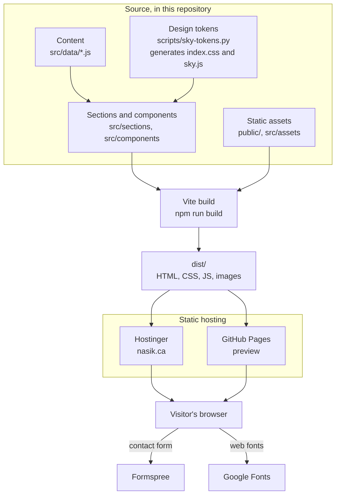
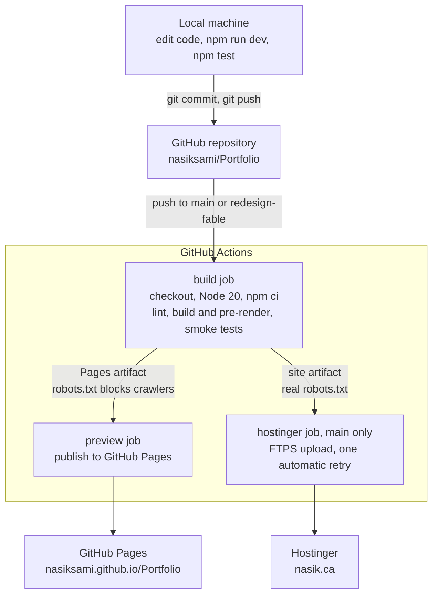
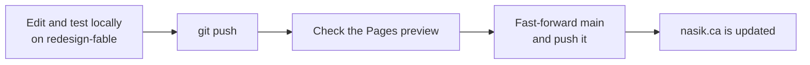

# Nasik Sami Khan — Portfolio

[](https://github.com/nasiksami/Portfolio/actions/workflows/deploy.yml)

The personal portfolio of **Nasik Sami Khan**, AI/ML Researcher & Full-Stack
Developer. It is a static React site, built, tested and deployed automatically
by GitHub Actions on every push.

> Driving innovation at the intersection of AI, ML, and software engineering.

| | |
| --- | --- |
| **Live site** | [nasik.ca](https://nasik.ca/), hosted on Hostinger |
| **Preview** | [nasiksami.github.io/Portfolio](https://nasiksami.github.io/Portfolio/), hosted on GitHub Pages |
| **Stack** | React 18, Vite 4, Tailwind CSS 3, Framer Motion |
| **CI/CD** | GitHub Actions: lint, build and smoke tests, then deploy to both hosts |
| **Design** | "Horizon", documented in [`DESIGN_NOTES_FABLE.md`](DESIGN_NOTES_FABLE.md) |

## Contents

- [Architecture](#architecture)
- [Delivery pipeline](#delivery-pipeline)
- [Day-to-day workflow](#day-to-day-workflow)
- [Setting up on a new machine](#setting-up-on-a-new-machine)
- [Repository settings the pipeline depends on](#repository-settings-the-pipeline-depends-on)
- [Troubleshooting deploys](#troubleshooting-deploys)
- [Branches](#branches)
- [Tech stack](#tech-stack)
- [Project structure](#project-structure)
- [Pre-rendering and routes](#pre-rendering-and-routes)
- [Design system — "Horizon"](#design-system--horizon)
- [Accessibility](#accessibility)
- [Performance](#performance)
- [Hosting notes](#hosting-notes)
- [Contact](#contact)

Reference documents for the November 2026 upgrade are in [`docs/`](docs/):
the audit, the decisions taken, the open questions and the final report.

## Architecture

The site has no backend and no database. All content is plain JavaScript data
in `src/data/`, the components render it, and the build compiles everything
into static files that any web host can serve.

Every page is **pre-rendered**: the build writes one HTML file per route with
the full content in the markup, and the browser bundle then hydrates it. A
search engine, an AI crawler or a visitor without JavaScript reads the same
page as everyone else. See [Pre-rendering and routes](#pre-rendering-and-routes).



Two outside services are used at runtime, and both are called from the
visitor's browser: **Formspree** receives contact-form submissions, and
**Google Fonts** serves the two typefaces. Neither needs a key or a secret in
this repository.

## Delivery pipeline

One workflow, [`.github/workflows/deploy.yml`](.github/workflows/deploy.yml),
takes a push from the local machine to both hosts. It builds once and deploys
the same build twice.



What each push deploys:

| Push to | nasik.ca (Hostinger) | Pages preview |
| --- | --- | --- |
| `main` | Yes | Yes |
| `redesign-fable` | No | Yes |
| any other branch | No | No |

How the pipeline is built:

- **Lint and tests are gates.** If `npm run lint` or a smoke test fails,
  nothing is deployed.
- **Smoke tests run against the production build,** on a desktop and a phone
  viewport. They check that the page loads without errors, every section
  renders, images load, the resume downloads, the project filter and the sky
  pin work, an empty contact form is rejected, and the page never scrolls
  sideways. They test structure and behaviour, not wording, so editing copy
  does not break them. See [`tests/smoke.spec.js`](tests/smoke.spec.js) and
  [`tests/prerender.spec.js`](tests/prerender.spec.js), which checks the HTML
  each route is served with, the 404 page, and the site without JavaScript.
- **One build, two artifacts.** The copy for nasik.ca keeps the real
  `robots.txt`. The Pages copy gets a `robots.txt` that blocks crawlers, so the
  preview never competes with the real domain in search results.
- **The two deploys are independent jobs.** A failure on one host does not
  stop the other.
- **The Hostinger upload is incremental.** It sends only files that changed
  and removes only files it uploaded itself. Anything else on the server is
  left alone. Hostinger sometimes drops the FTP connection mid-transfer, so a
  failed first attempt is retried once.
- **Credentials never touch the repository.** The FTP host, username and
  password are GitHub repository secrets. If they are missing, the upload is
  skipped with a warning and the rest of the workflow still passes.
- **The third-party upload action is pinned to a commit**, not a moving tag.

## Day-to-day workflow

A push to `main` updates both sites. To look at a change before it goes
live, push it to `redesign-fable` first, which updates only the preview, and
then promote it to `main`.



```bash
# 1. Work on the development branch
git switch redesign-fable
npm run dev                      # http://localhost:5173

# 2. Check the change the way CI will
npm run lint
npm test                         # builds, then runs the smoke tests

# 3. Commit and push: this deploys the Pages preview
git add -A
git commit -m "content: describe the change"
git push

# 4. After checking the preview, promote to main: this deploys nasik.ca
git push origin redesign-fable:main
```

Step 4 is a fast-forward: it moves `main` to the same commit without a merge
commit. It is refused if `main` has commits that `redesign-fable` does not, in
which case merge `main` into `redesign-fable` first.

To skip the preview, commit on `main` and `git push`: that deploys to both
sites directly.

**Rolling back.** Every deploy is a commit, so the previous version is always
one command away. `git revert <commit>` followed by `git push` undoes a change
and redeploys the site without it.

Each run can be followed under the repository's
[Actions tab](https://github.com/nasiksami/Portfolio/actions). A deploy takes
about two minutes.

## Setting up on a new machine

Everything needed to build and deploy the site is in this repository or in
GitHub's settings. Nothing has to be copied from an old computer.

### 1. Install the prerequisites

| Tool | Version | Needed for |
| --- | --- | --- |
| Git | any recent | cloning and pushing |
| Node.js | 20 or newer (CI uses 20; `.nvmrc` pins it for nvm users) | building and running the site |
| npm | bundled with Node.js | installing dependencies |
| Python 3 | any, no packages | only for regenerating the colour tokens |

### 2. Give the machine access to GitHub

Pushing requires authentication. Either works:

- **SSH:** create a key with `ssh-keygen -t ed25519`, then add the public key
  under GitHub → Settings → SSH and GPG keys.
- **HTTPS:** clone with the HTTPS URL and sign in when Git asks, or install the
  GitHub CLI and run `gh auth login`.

Set the identity that commits are recorded under:

```bash
git config --global user.name  "Nasik Sami Khan"
git config --global user.email "you@example.com"
```

### 3. Clone, install and run

```bash
git clone git@github.com:nasiksami/Portfolio.git
cd Portfolio
git switch redesign-fable        # the development branch

npm ci                           # exact dependencies from package-lock.json
npx playwright install chromium  # the browser the smoke tests drive
npm run dev                      # dev server at http://localhost:5173
```

Use `npm ci`, not `npm install`, on a fresh clone: it installs exactly the
versions recorded in `package-lock.json`, the same ones CI builds with.

### 4. Confirm the machine can ship

```bash
npm run lint                     # must pass, CI runs the same check
npm test                         # builds to dist/, then runs the smoke tests
npm run preview                  # serves dist/ at http://localhost:4173
```

If these pass, a `git push` from this machine deploys exactly as before.

### What lives where

| Item | Where it lives | Action on a new machine |
| --- | --- | --- |
| Source code, content, assets, resume | This repository | `git clone` |
| Dependency versions | `package-lock.json` | `npm ci` |
| CI/CD pipeline | `.github/workflows/deploy.yml` | None |
| Hostinger FTP credentials | GitHub repository secrets | None |
| GitHub Pages configuration | GitHub repository settings | None |
| Contact form endpoint | Formspree, form ID in `src/sections/Contact.jsx` | None |
| Domain and DNS for nasik.ca | Hostinger account | None |
| `node_modules/`, `dist/` | Generated locally, not committed | Recreated by `npm ci` and `npm run build` |

Three things are **not** carried by a clone and exist only on the machine that
made them: uncommitted changes, `git stash` entries, and tags or branches that
were never pushed. Commit and push, or deliberately discard, anything that
matters before retiring a machine. `git status`, `git stash list` and
`git push --tags` cover all three.

### All commands

```bash
npm ci          # install the locked dependencies
npm run dev     # dev server at http://localhost:5173
npm run build   # production build to dist/
npm run preview # serve dist/ at http://localhost:4173, like the real hosts
npm run lint    # ESLint, including accessibility rules
npm test        # production build, then the Playwright smoke tests
```

## Repository settings the pipeline depends on

These are already configured on `nasiksami/Portfolio`. They are listed so the
pipeline can be rebuilt if the repository is ever forked or recreated.

| Setting | Location in GitHub | Value |
| --- | --- | --- |
| Pages source | Settings → Pages → Build and deployment | GitHub Actions |
| Pages deploy branches | Settings → Environments → `github-pages` → Deployment branches | `main`, `redesign-fable` |
| `HOSTINGER_FTP_HOST` | Settings → Secrets and variables → Actions → **Repository secrets** | FTP hostname or IP, without `ftp://` |
| `HOSTINGER_FTP_USER` | same | FTP username |
| `HOSTINGER_FTP_PASSWORD` | same | FTP password |
| `HOSTINGER_FTP_DIR` (optional) | Settings → Secrets and variables → Actions → Variables | Remote folder; defaults to `./` |

The FTP details come from Hostinger's hPanel, under Files → FTP Accounts. The
secrets must be **repository** secrets. Environment secrets are not visible to
the upload job.

The FTP account opens inside `public_html`, the folder nasik.ca is served
from, so the workflow uploads to the account's root (`./`). Set
`HOSTINGER_FTP_DIR` only if a different FTP account or folder is used.

## Troubleshooting deploys

| Symptom | Cause | Fix |
| --- | --- | --- |
| Warning "HOSTINGER_FTP_HOST is not set", nasik.ca unchanged | The secrets are missing, misnamed, or stored as environment secrets | Add the three repository secrets listed above, then re-run the workflow |
| Upload succeeds but nasik.ca is unchanged | Files went to the wrong folder, for example `public_html/public_html` | Set `HOSTINGER_FTP_DIR` to the folder the domain is served from |
| "read ECONNRESET (data socket)" | Hostinger dropped the FTP connection | The workflow retries once by itself; if both attempts fail, re-run the job |
| The preview job fails on a branch | The branch is not allowed to deploy to Pages | Add it under Environments → `github-pages` → Deployment branches |
| The build job fails | A lint, build or smoke-test error | Run `npm run lint` and `npm test` locally and fix what they report |

## Branches

| Branch | Purpose | Deploys to |
| --- | --- | --- |
| `main` | Production. Whatever is here is what nasik.ca serves. | nasik.ca and the preview |
| `redesign-fable` | Development branch for the current "Horizon" design. | The preview |
| `redesign` | An earlier design exploration, "Specimen №". Kept for reference. | Not deployed by this workflow |
| `redesign-codex` | An earlier design exploration, "Signal Cartography". Kept for reference. | Not deployed by this workflow |

The two earlier branches carry their own older workflow files. Pushing to
`redesign` would publish that design to the Pages preview, replacing the
current one, so leave those branches as they are unless that is intended.

## Tech stack

| Concern   | Choice                                          |
| --------- | ----------------------------------------------- |
| Framework | React 18 (function components + hooks)          |
| Build     | Vite 4                                          |
| Styling   | Tailwind CSS 3 with generated CSS-variable tokens |
| Animation | Framer Motion                                   |
| Type      | Fraunces (display) and Public Sans (text), via Google Fonts |
| Icons     | react-icons (Simple Icons, Feather, FA)         |
| Forms     | Formspree                                       |
| Linting   | ESLint + react-hooks + jsx-a11y                 |
| Testing   | Playwright smoke tests                          |
| CI/CD     | GitHub Actions                                  |
| Hosting   | Hostinger (production), GitHub Pages (preview)  |

## Project structure

```
src/
├── data/            # ← All site content lives here. Edit these, not components.
│   ├── profile.js       name, bio + bio headings, stats, focus areas, socials, nav order
│   ├── projects.js      project cards + filter categories
│   ├── experience.js    professional timeline
│   ├── education.js     degrees + awards/scholarships
│   ├── skills.js        skill groups, and a short list of earlier tools
│   ├── publications.js  papers, thesis, venues, links, grouped by type
│   └── caseStudies.js   the three case-study pages under /projects/
├── components/
│   ├── ui/
│   │   ├── Section.jsx    Sky row, horizon rule, ground row; places a section on the day arc
│   │   ├── Emphasis.jsx   Marks metrics and named technologies in running copy
│   │   ├── Reveal.jsx     Scroll-triggered entrance, transform and opacity only
│   │   ├── Button.jsx
│   │   └── Tag.jsx
│   ├── Navbar.jsx      Sticky nav, scroll-spy, sky pin control, mobile menu
│   ├── Footer.jsx      Closing ground, contact links and navigation
│   ├── FlowDiagram.jsx Architecture diagram drawn as an ordered list of steps
│   ├── HorizonRule.jsx The 1px horizon line with its glow
│   ├── Aurora.jsx      Drifting aurora bands behind Contact
│   ├── SkillIcon.jsx   Slug → icon registry, with monogram fallback
│   ├── SocialLinks.jsx
│   └── BackToTop.jsx
├── hooks/
│   ├── useSky.js         Keeps the header chrome on the day arc as you scroll
│   ├── useSkyPin.js      Live / Day / Night pin, persisted in localStorage
│   ├── useScrollSpy.js   Scroll-position-based active section
│   ├── useHashScroll.js  Deep links into lazy sections
│   └── useCountUp.js     Stat numerals, reduced-motion safe
├── sections/        One component per home-page section
├── pages/
│   ├── Home.jsx         The home page: the sections, in order
│   └── CaseStudy.jsx    Layout of a case-study page
├── App.jsx          The frame every page shares: skip link, nav, main, footer
├── site.js          The route table, and helpers for linking between pages
├── seo.js           Title, description, social tags and JSON-LD for each route
├── entry-client.jsx Browser entry: hydrates the pre-rendered page
├── entry-server.jsx Build-time entry: renders a route to HTML
├── sky.js           Day-arc knots, section spans, gradient and palette helpers
└── index.css        Type scale, generated sky tokens, base styles
scripts/
├── prerender.mjs    Writes dist/<route>/index.html, sitemap.xml and 404.html
├── serve-dist.mjs   Serves dist/ the way the production hosts do
├── og-image.mjs     Draws public/og-image.png (run by hand)
└── sky-tokens.py    Generates and contrast-checks the sky token block
```

The home page order is Hero, About, Experience, Publications, Projects, Skills
and Contact. It is set in `pages/Home.jsx` and mirrored by `navLinks` in
`profile.js`.

## Pre-rendering and routes

| Route | Page |
| --- | --- |
| `/` | Home |
| `/projects/telecom-rag/` | Case study |
| `/projects/incident-management/` | Case study |
| `/projects/heritage-hive/` | Case study |

`npm run build` runs three steps:

1. `vite build` compiles the browser bundle into `dist/`.
2. `vite build --ssr src/entry-server.jsx` compiles the same components for
   Node into `dist-ssr/`.
3. `node scripts/prerender.mjs` renders every route in `src/site.js` to HTML
   and writes `dist/<route>/index.html`, each with its own `<head>` from
   `src/seo.js`. It also writes `dist/sitemap.xml` and `dist/404.html`, then
   deletes `dist-ssr/`.

**Adding a page** means adding a route to `ROUTES` in `src/site.js` and
rendering it in `App.jsx`. A new case study needs only an entry in
`src/data/caseStudies.js` and a route; the sitemap, head tags and 404 links
follow from the route table.

**Links between pages are relative.** The site is served at a domain root
(nasik.ca) and under a subdirectory (the Pages preview), so nothing may start
with `/`. Use the helpers from `useSite()` in `src/site.js`: `to()` for a page
or file, `home()` for a home-page section, `asset()` for an imported image.

**Server and client must render the same markup.** Anything that depends on
the browser (stored preferences, `window`, media queries) belongs in an
effect, not in the first render. `Reveal` and the hero entrance are CSS for
this reason: content is hidden only under the `.js` class that an inline
script in `index.html` sets, so the markup is visible without JavaScript and
identical on both sides. To check for mismatches, build with React in
development mode and watch the console: `NODE_ENV=development npm run build`,
then `npm run preview`.

### Editing content

All copy and data lives in `src/data/`. Adding a project means appending an
object to `projects.js`, with no component changes. Skills resolve their icons
by slug through `components/SkillIcon.jsx`. A slug with no registered icon
renders a styled monogram rather than breaking.

**Content follows the resume.** Titles, dates and figures in `src/data/` match
`public/Nasik_Sami_Khan_Resume.pdf`, and every research figure is quoted from
the paper it is attributed to. Change the resume and the data together.

**Emphasis is automatic.** Metrics such as `37%`, `$35,000+` and `100+`, and
the name of any tool in the skills list or a project's stack, render in
semibold wherever they appear in project text, experience bullets, case
studies and the About section. The term list is built from `skills.js` and
each project's `tech` array, so content needs no markup. Matching is
case-sensitive. A skill with `term: false` is a descriptive phrase and is not
matched.

**The About profile** pairs each paragraph in `bio` with the heading at the
same position in `bioLabels`. Keep the two arrays in step.

**Publication covers** are optional: a `cover` image on an entry in
`publications.js` shows beside it, linked to the paper. Seven are the paper's
first page, rendered once from its PDF to a 320px WebP in
`src/assets/papers/`. The book chapter uses the book's jacket, and any entry
with `type: 'Book chapter'` is drawn as a book with a spine.

## Design system — "Horizon"

A Saskatchewan prairie sky read as one continuous document. Every section is
three rows: a transparent **sky**, a 1px **horizon rule**, and a **ground**
surface below it. Down the page, the sky moves through one day, from a calm
slate-navy pre-dawn behind the hero, through morning and noon, to sunset,
night, and an aurora behind Contact.

See [`DESIGN_NOTES_FABLE.md`](DESIGN_NOTES_FABLE.md) for the full rationale,
the measurements, and how to roll back.

### The sky and its tokens

- **One input.** A registered `--sky` custom property, from 0 to 1, decides
  every colour. `src/index.css` blends eight palette **keyframes** (pre-dawn,
  dawn, morning, noon, afternoon, dusk, night, aurora) into semantic tokens:
  `surface-*`, `content-*`, `edge`, `accent`, `on-accent`, `signal`,
  `on-signal`.
- **Painted, not animated.** Each section is placed on the arc once, at render,
  by `skyProps()` in `src/sky.js`. Its text palette is the nearest keyframe,
  and its background is a gradient through its stretch of the day, so
  adjacent sections join seamlessly. Scrolling restyles nothing. Only the
  header chrome follows the scroll, through `useSky`.
- **A section's time of day comes from its position,** not its subject.
  Reordering sections keeps the sky continuous, as long as the spans in
  `ARC` in `sky.js` still follow document order.
- **Tailwind-compatible.** Tokens are RGB channel triples, so utilities like
  `bg-surface-base/60` and `text-accent` work as usual.

**Pin the sky.** The header's Live / Day / Night control freezes the arc at
noon or night. It writes to `localStorage` only when the visitor clicks,
under the existing `theme` key, so a preference saved by an earlier design
carries over. An inline script in `index.html` applies it before first paint.
Unpinned visitors follow the arc, not the OS colour scheme.

### Editing the palette

Never edit the numbers between the `GENERATED` markers in `index.css` by hand.
The keyframe colours live in the table at the top of `scripts/sky-tokens.py`:

```bash
python3 scripts/sky-tokens.py           # check every keyframe and print the blocks
python3 scripts/sky-tokens.py --write   # regenerate index.css and sky.js
```

The script verifies WCAG AA for every keyframe and sweeps the whole arc. It
also places the two points where text flips between dark and light ink, at
sunrise and sunset. Re-running it on an unchanged table is a no-op.

### Typography

One modular scale (major third, 1.25) from a fluid base of 17px on phones and
18px on desktop, with 1.65 line-height. The steps are CSS custom properties
mapped onto Tailwind's `text-xs` … `text-4xl`.

| Class | Use |
| ----- | --- |
| `.hero-name` | The name: one line at every width, up to 96px |
| `.d-1` | Section headings, up to ~86px |
| `.d-2` | Project titles, publication years |
| `.d-3` | Entry and group titles |
| `.d-stat` | Stat numerals |
| `.subhead` | Text-face subheads, clearly secondary to display headings |
| `.meta`, `.meta-sm` | Tracked uppercase metadata with tabular figures |

Running text is held to `max-w-prose`, which is 54ch and measures about 61–71
characters a line.

**All text tokens meet WCAG 2.1 AA (≥ 4.5:1)** against every surface they sit
on, at every point of the arc. If you change a colour, run the generator.

## Accessibility

- Semantic landmarks (`header`, `main`, `nav`, `footer`) and a skip link.
- Section headings wired via `aria-labelledby`.
- Visible focus outlines on all interactive elements (`:focus-visible`).
- Project filtering uses `aria-pressed` and announces results through an
  `aria-live` region.
- Timeline disclosures use `aria-expanded` / `aria-controls`.
- The sky pin is a group of `aria-pressed` buttons with accessible labels.
- The mobile menu traps focus, closes on Escape, restores focus, and locks
  background scroll.
- Form errors use `aria-invalid`, `aria-describedby`, and `role="alert"`, and
  focus moves to the first invalid field on submit.
- `prefers-reduced-motion` disables Framer Motion animations, CSS animation
  and smooth scrolling, and snaps the header chrome to the nearest keyframe.
- Decorative visuals are `aria-hidden`.

## Performance

- Every page is pre-rendered, so its content paints from the HTML, before any
  script runs.
- Below-the-fold sections are `React.lazy` code-split. Their markup is in the
  page already; the chunks only make them interactive.
- The sky is painted once per section, so scrolling triggers no palette
  restyle. A scripted full-page scroll drops no frames.
- Sky tokens are registered with `@property` as numbers, so each resolves
  once rather than per element.
- The hero entrance is transform-only, so its text counts as painted
  immediately for Largest Contentful Paint.
- Both web fonts have size-adjusted local fallbacks, to limit layout shift
  when they load.
- Timeline logos are `loading="lazy"`, and the hero portrait is
  `fetchpriority="high"`.
- Animation is limited to transform and opacity, and there is no
  `backdrop-filter`.

Lighthouse has not been re-run since pages became pre-rendered. The figures
measured for that change, and how they were taken, are in
[`docs/UPGRADE_REPORT.md`](docs/UPGRADE_REPORT.md).

## Hosting notes

`vite.config.js` sets `base: './'` for relative asset paths, so the same build
works at a domain root (nasik.ca) and under a subdirectory (the Pages
preview). Links between pages and to the resume are relative for the same
reason; see [Pre-rendering and routes](#pre-rendering-and-routes).

`public/.htaccess` gives nasik.ca its own 404 page and redirects the resume's
old address, `/resume.pdf`, to the current file. GitHub Pages ignores that
file and serves `404.html` for unknown URLs by itself.

The build is plain static files, so it also runs on any other static host:
build command `npm run build`, output directory `dist`.

After a domain change, update `SITE_URL` in `src/site.js` and the `Sitemap`
line in `public/robots.txt`. Canonical, Open Graph and sitemap URLs are all
generated from `SITE_URL`.

## Contact

- [LinkedIn](https://www.linkedin.com/in/nasiksami)
- [GitHub](https://github.com/nasiksami)
- [Google Scholar](https://scholar.google.com/citations?hl=en&user=NCdDTeEAAAAJ)
- [X](https://x.com/NasikSami)
- [nasiksami@gmail.com](mailto:nasiksami@gmail.com)
